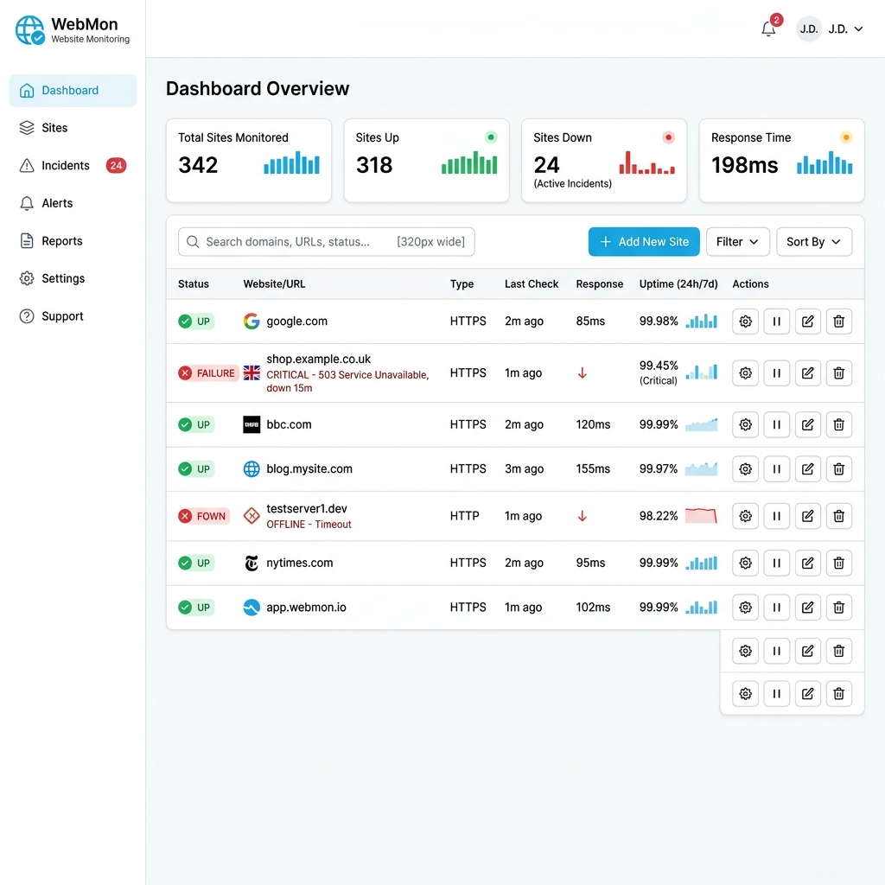
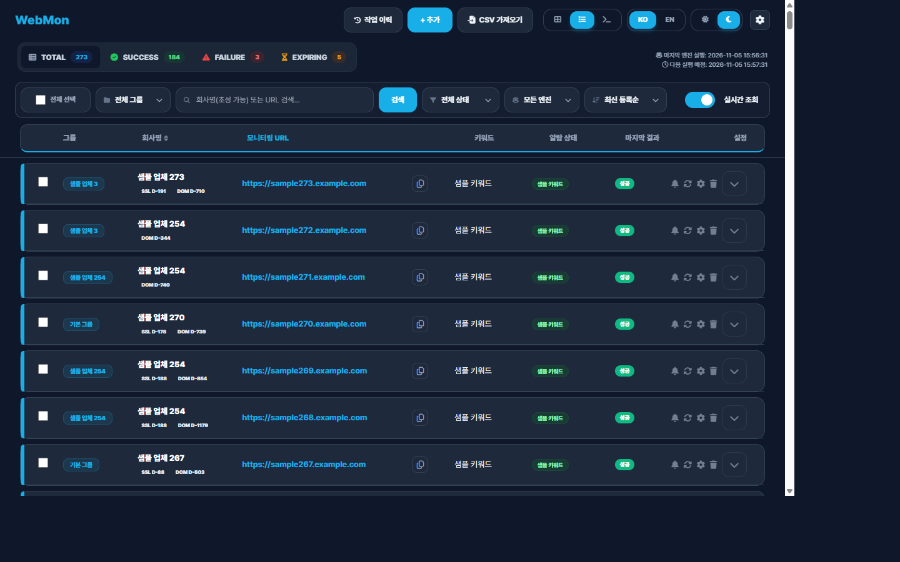
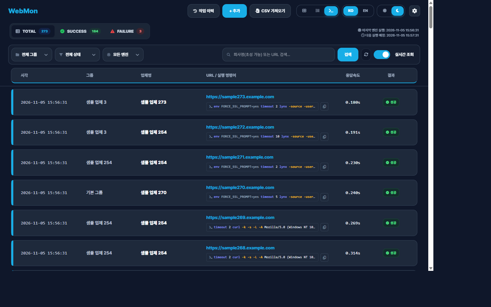
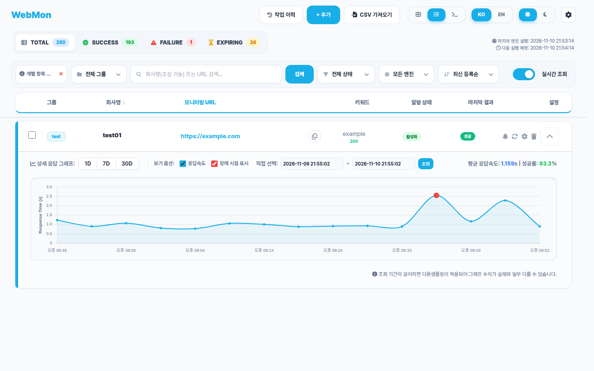
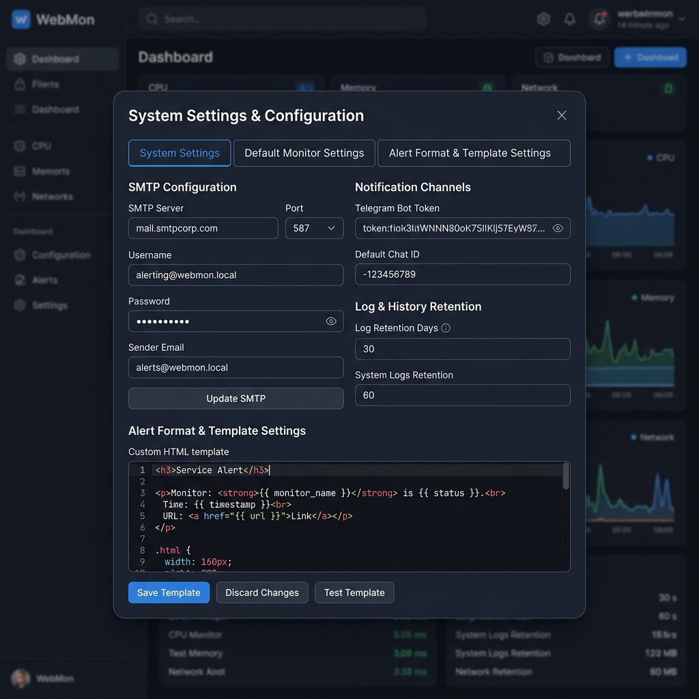
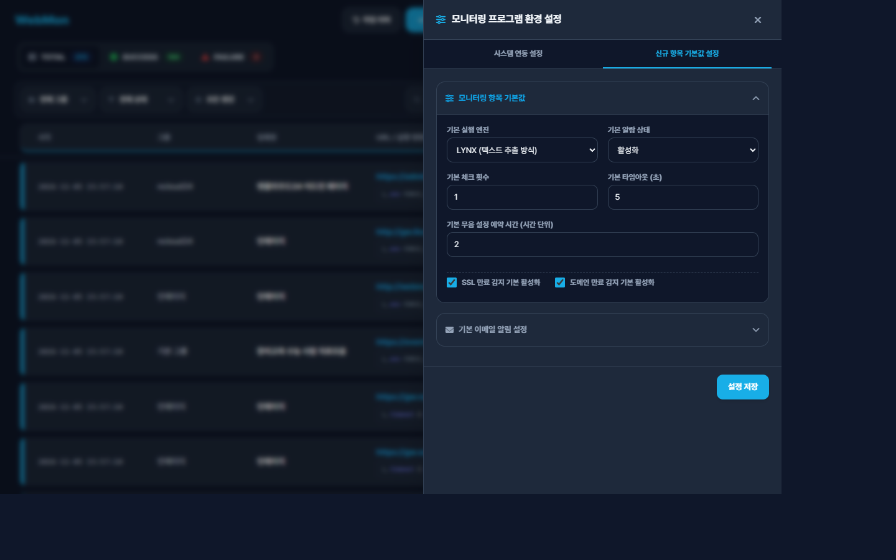
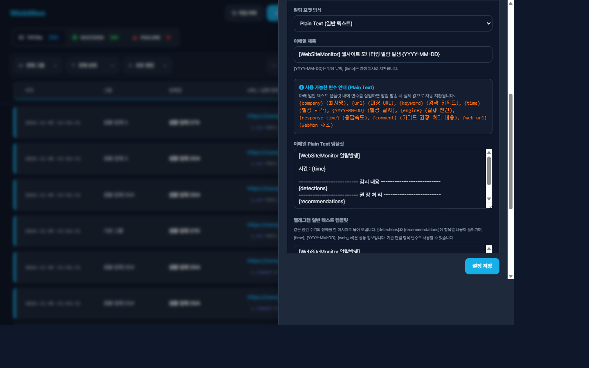
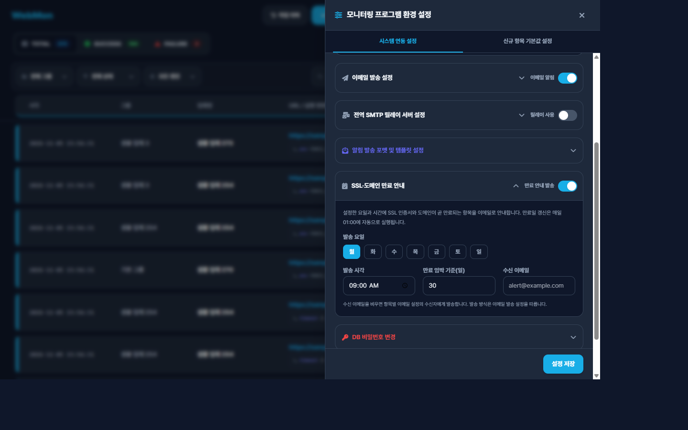
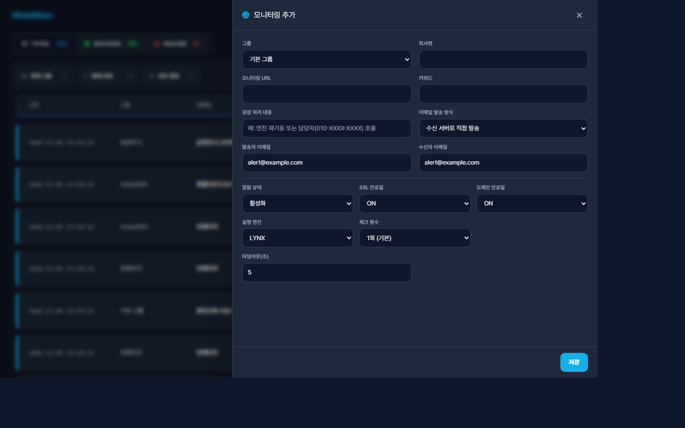

# 📊 WebMon 사용자 및 관리자 가이드 매뉴얼

WebMon은 **PHP (Frontend) + MariaDB (Database) + Python asyncio (Scheduler)** 기반의 초고속 실시간 웹사이트 모니터링 및 장애 전파 시스템입니다. 본 문서는 WebMon의 모든 주요 기능과 화면 구성, 설정 가이드 및 장애 관리법을 포함하는 공식 매뉴얼입니다.

---

## 💾 시스템 권장 서버 사양 (Server Specifications)

WebMon은 매우 경량화된 인프라 구조와 고성능 비동기 스케줄러 설계 덕분에, 상용 클라우드의 가장 최저가 인스턴스(VPS) 사양에서도 수많은 도메인을 무리 없이 검사할 수 있습니다.

### 1. 하드웨어 사양 가이드라인
* **최소 사양 (Minimum specs)**:
  * **CPU**: 1 Core (vCPU)
  * **RAM**: 1 GB (리눅스 Swap 메모리 1~2GB 설정 필수)
  * **Storage**: 20 GB SSD 이상
  * **감시 한계**: 도메인 500개 이하 모니터링, 로그 30일 보존 기준
* **권장 사양 (Recommended specs)**:
  * **CPU**: 2 Cores 이상
  * **RAM**: 2 GB ~ 4 GB
  * **Storage**: 50 GB SSD 이상
  * **감시 한계**: 도메인 1,000 ~ 3,000개 모니터링 및 장기 데이터 축적 기준
* **운영체제(OS)**: Docker 및 Docker Compose 구동이 가능한 모든 Linux 배포판 (Rocky Linux 8/9, Ubuntu 20.04/22.04 등)

### 2. 성능 분석 및 부하 성능 데이터 (Load Test & Benchmark)
* **대기 시 리소스 점유**:
  * 4개의 서비스 컨테이너(웹 UI, DB, 메일 전송, 파이썬 스케줄러)가 대기하는 동안 점유하는 상시 메모리 총합은 **약 190 MB** 수준으로 극도로 가볍습니다.
* **스루풋(Throughput) 성능 벤치마크**:
  * 시스템에서 프로세스 생성 및 동시성 30개 제한(`ALERT_CONCURRENCY=30`) 조건으로 검사 스루풋을 테스트한 결과, **초당 61.42개 대상(targets/sec)**을 완벽하게 검증하고 로그 인서트를 처리해 냅니다.
  * 감시 대상 도메인이 **1,000개**로 늘어나도, 1분 주기가 실행되었을 때 전체를 체크하는 데 걸리는 시간은 **약 16.3초**에 불과해 60초 시간 범위 안에서 매우 안정적으로 처리를 완료하고 유휴 상태로 들어갑니다.
* **디스크 데이터 증가 트렌드**:
  * 1,000개 타겟을 1분 주기로 매번 체크해 로그를 DB에 적재할 경우 하루에 쌓이는 데이터는 **약 144 MB**, 30일간 누적될 경우 **약 4.3 GB**의 용량이 데이터베이스 볼륨으로 확보되어야 합니다. SSD 용량 산정 시 참고하십시오.

---

## 📸 주요 화면 미리보기

| 카드 뷰 (기본) | 리스트 뷰 |
| :---: | :---: |
|  |  |

| 실시간 로그뷰 | 상세 분석 및 시계열 차트 |
| :---: | :---: |
|  |  |

> 화면 속 업체명·URL은 개인정보 보호를 위해 샘플 값으로 대체한 것입니다.

---

## 🛠️ 주요 기능 목록

### 1. 실시간 모니터링 엔진
* **이중 엔진 지원**: **LYNX 엔진**(실제 브라우저 렌더링에 가까운 헤드리스 텍스트 환경 시뮬레이션)과 **CURL 엔진**(빠르고 경량화된 HTTP 요청) 중 선택하여 진단합니다.
* **키워드 매칭 검증**: 단순히 HTTP 상태 코드 200만 확인하는 것이 아니라, HTML 본문 내에 **특정 키워드가 정상적으로 노출되는지** 실시간 매칭 검증하여 콘텐츠 손상 및 화이트 스크린 장애를 완벽하게 탐지합니다.

### 2. 보안 및 자격 증명 격리
* **비밀번호/토큰 격리 관리**: 텔레그램 봇 토큰, Chat ID, 이메일 SMTP 로그인 비밀번호와 변경된 DB 비밀번호는 데이터베이스 및 Git 저장소에 넣지 않고, 웹·스케줄러가 공유하는 비공개 Docker 런타임 볼륨에 저장합니다. 기본 설정은 `.env`에서 읽습니다.
* **실시간 DB 비밀번호 변경**: 기본 비밀번호 사용 중에는 이전 비밀번호 입력을 생략할 수 있으며, 사용자 지정 비밀번호는 기존 비밀번호 확인 후 변경합니다. 웹과 스케줄러가 공유하는 런타임 볼륨을 통해 변경 사항을 적용하므로 컨테이너 재시작이 필요하지 않습니다.
* **관리자 DB 비밀번호 복구**: 기존 비밀번호를 모르는 경우 서버에서 `podman-compose --profile maintenance run --rm db-password-reset`을 실행하면 `.env`의 `DB_PASS`로 복구합니다. 웹 요청으로는 실행할 수 없으며, DB 데이터는 삭제하지 않습니다.

### 3. 유연한 알림 서비스 (Email & Telegram)
* **다양한 발송 모드**: 이메일 알림은 **수신 도메인 메일 서버로 직접 발송**하거나 **활성화한 외부 SMTP 릴레이를 통해 발송**할 수 있습니다.
* **이메일 알림 전역 스위치**: 환경 설정에서 이메일 발송을 일괄로 켜거나 끌 수 있습니다. 전역 OFF 상태에서는 항목별 이메일 설정과 무관하게 이메일을 발송하지 않습니다.
* **전역 기본 발송 주소**: 환경 설정의 이메일 발송 설정에서 기본 From 주소를 지정할 수 있습니다. 모니터링 항목에 발송자 주소가 별도로 지정된 경우에는 항목별 주소가 우선합니다. SMTP 서버 연결 정보는 전역 SMTP 릴레이 서버 설정에서 별도로 관리합니다.
* **개별 발신/수신 이메일 제어**: 각 모니터링 대상마다 서로 다른 알람 발송자(From)와 수신자(To) 이메일 주소를 개별 커스텀 지정할 수 있습니다.
* **타겟별 전용 SMTP 지정**: 관리 도메인별로 발송 서버를 별도로 구성해야 하는 경우를 위해, **모니터링 항목별 개별 SMTP 서버 설정**을 지원합니다.
* **여러 업체를 한 통으로 묶어 발송**: 같은 점검 주기에 발생한 장애는 업체별로 따로 보내지 않고 텔레그램 1건, 이메일은 발송 설정(방식·발신자·수신자·SMTP)이 같은 항목끼리 1통으로 묶어 보냅니다. 감지 내용과 권장 처리에는 `| 1.`, `| 2.` 형태의 번호가 붙어 업체와 조치 내용을 서로 대응시켜 볼 수 있습니다.
* **이메일 제목 설정**: 시스템 연동 설정 > 알림 발송 포맷 및 템플릿에서 제목을 바꿀 수 있습니다. 기본값은 `[WebSiteMonitor] 웹사이트 모니터링 알람 발생 {YYYY-MM-DD}`이며 `{YYYY-MM-DD}`(발생 날짜)와 `{time}`(발생 일시)을 쓸 수 있습니다. 업체명은 제목에 붙지 않습니다.
* **권장 처리 줄바꿈**: 권장 처리 내용에 줄바꿈이나 `\n` 문자가 있어도 실제 줄바꿈으로 변환되어 들여쓰기에 맞춰 표시됩니다.
* **HTML/Plain Text 포맷 커스터마이징**: 알림 형식을 일반 텍스트 또는 서식 있는 HTML 템플릿 형태로 선택할 수 있으며, 이메일 및 텔레그램 템플릿을 관리자 화면에서 치환 변수(예: `{company}`, `{url}`, `{response_time}`)를 활용해 마음대로 수정할 수 있습니다.

### 4. 도메인 및 SSL 만료 예정일 추적
* **SSL 인증서 만료 감지**: 타겟 서버의 SSL 핸드셰이크를 분석하여 남은 만료 일수를 추적하고 만료 임박 시 알람을 발송합니다.
* **WHOIS 도메인 만료 추적**: 국내 KISA Whois API 규격(한국 2단계 TLD인 `co.kr`, `or.kr` 등 포함) 및 글로벌 Whois 서버 연동을 지원하여 도메인 만료를 실시간으로 추적합니다.
* **만료 예정 안내 메일 (이메일 전용)**: 설정한 요일·시각(기본 매주 월요일 09:00)에 만료 임박 기준일(기본 30일) 이내인 SSL·도메인 목록을 WebMon 스타일의 HTML 메일로 발송합니다. 텔레그램으로는 발송하지 않으며, 각 항목에 D-day 배지(7일 이내 빨강, 14일 이내 주황, 그 외 회색)와 대시보드 바로가기 버튼이 들어갑니다. 설정 방법은 아래 [사용 가이드](#-사용-가이드-따라-하기)를 참고하세요.
* **만료일 자동 갱신**: 매일 01:00에 SSL 인증서와 WHOIS로 만료일을 갱신합니다. 안내 메일은 갱신된 값을 기준으로 만들어집니다.
* **스마트 WHOIS 조회 주기 (차단 방지)**: 만료일이 3일 초과로 많이 남아있고 최근 7일 내 갱신 이력이 있는 도메인은 당일 WHOIS 조회를 건너뜀으로써 후이즈 서버의 IP 차단을 방지합니다. (만료일 3일 이하 도메인은 매일 새벽 1시 자동 업데이트)
* **만료 도메인 강제 정탐 및 10분 쿨타임 자동 복구**:
  - 도메인 만료일이 지난 경우 캐시 오탐 등으로 인한 `lynx`/`curl` 성공 여부와 관계없이 무조건 `도메인 만료 실패` 처리하여 정탐을 보장합니다.
  - 연장(갱신) 조치로 인해 정상 접속 신호가 1분 내로 캐치되면 즉시 WHOIS 질의를 1회 자동 트리거하여 최신 만료일로 갱신 및 정상 자동 복구를 완료합니다.
  - 임시 성공 상태가 지속되는 캐시 오탐 환경에서 WHOIS 서버로의 쿼리 폭주를 막기 위해 실시간 WHOIS 조회 시 **10분 쿨타임**이 강제 적용됩니다.
* **대시보드 내 만료일 임박 시각적 표시**:
  - 만료 모니터링이 활성화된 대상에 대하여 남은 만료 일수(`D-Day`)를 실시간으로 계산해 강조 색상을 적용합니다.
  - **D-30 ~ D-15 (주황색, Amber):** 만료 예정일이 다가왔음을 시각적으로 경고합니다.
  - **D-14 이하 및 경과 (빨간색, Red):** 임박 및 만료가 발생했음을 표시하여 빠른 갱신 대처를 유도합니다.

### 5. 임시 알람 무음(Mute) 스케줄러
* **개별 일시 무음 제어**: 특정 서버의 점검이나 작업 시, 해당 타겟의 알람만 일정 시간 동안 무음 처리(기본 2시간 또는 직접 지정 시간까지)하여 불필요한 알람 피로를 방지합니다.
* **일괄 무음 스케줄**: 선택한 여러 대상에 동일한 무음 종료 시각을 적용하거나 기존 무음 스케줄을 해제할 수 있습니다.

---

## 🖥️ 화면별 기능 가이드

### 1. 메인 대시보드

대시보드의 마지막 엔진 실행 시각은 모니터링 실행 로그 기준으로 표시됩니다. 설정 수정, SSL/도메인 정보 확인 시각은 별도 필드로 관리되어 실행 시각을 덮어쓰지 않습니다.

상단의 **CSV 가져오기**에서 템플릿을 내려받아 `company`, `url`, `contents` 열을 작성한 뒤 업로드할 수 있습니다. 등록 전 미리보기가 제공되며 최대 500행, 5MB까지 지원합니다. 기존 URL이나 같은 파일 안의 중복 URL은 건너뛰고 기존 설정은 덮어쓰지 않습니다. 가져오기는 작업 이력에 기록되며 원복할 수 있습니다.
같은 창의 **현재 항목 CSV 저장**은 화면 필터와 관계없이 등록된 전체 모니터링 설정을 다운로드합니다. SMTP 비밀번호 같은 비밀 정보와 모니터링 이력은 내보내지 않습니다.

* **실시간 요약 통계**: 상단 헤더에 `TOTAL(전체 수)`, `SUCCESS(정상 수)`, `FAILURE(장애 수)`, `EXPIRING(만료 임박)` 카운트가 실시간 표시되며, 클릭 시 해당 상태의 타겟들만 필터링됩니다.
  * **`EXPIRING` 필터:** 30일 이내에 도메인 혹은 SSL 인증서가 만료될 모든 활성 항목을 한꺼번에 가져와 필터링해 줍니다.
* **리스트 뷰 내 만료 정보 노출**:
  - 리스트 뷰에서도 한눈에 만료 상태를 볼 수 있도록 회사명 컬럼 하단에 `SSL (D-N)` / `DOM (D-N)` 뱃지가 경량화된 레이아웃으로 출력되며 동일한 위협 수준 색상이 적용됩니다.
* **필터링 & 정렬**: 
  * **그룹별**: 등록된 그룹별로 도메인을 필터링하여 볼 수 있습니다.
  * **상태별**: 경보(Alarm), 경보 해제(No Alarm), 모니터링 비활성화(Disable) 및 타임아웃 유형별 필터링을 지원합니다.
  * **엔진별**: LYNX 엔진 사용 항목과 CURL 엔진 사용 항목을 구분해 볼 수 있습니다.
  * **정렬**: 최신순, 회사명 가나다순(오름차순/내림차순), 체크 횟수 순, 상태별 정렬을 지원합니다.
* **일괄 상태 변경 및 일괄 삭제**:
  * 여러 항목을 좌측 체크박스로 선택한 후 우측 상단의 일괄 작업 버튼을 눌러 경보 활성화, 비활성화, 일시 무음(기본 2시간) 처리 및 일괄 삭제를 수행할 수 있습니다.
  * 모니터 추가·수정, 일괄 설정, 환경 설정, 작업 이력은 우측에서 열리는 시트 패널에서 관리합니다. 삭제와 원복은 중앙 확인 창에서 대상 목록을 검토한 뒤 진행하며, 작업 결과와 입력 안내는 우측 하단 토스트로 표시됩니다.

### 2. 시계열 차트 및 응답 속도 추이 (아코디언)
모니터링 리스트에서 도메인의 아코디언 메뉴를 클릭하면 아래 상세 분석 창이 열립니다.
* **시계열 라인 차트**: 최근 1일(1D), 7일(7D), 30일(30D) 간의 웹사이트 응답속도 추이를 시계열 꺾은선 그래프로 파악할 수 있습니다.
* **24시간 기준 직접 범위 조회 (Flatpickr 연동)**:
  * 연도가 4자리(`YYYY-MM-DD HH:MM:SS`)로 시작하는 24시간 형식의 시간 선택기가 도입되어 날짜와 시, 분, 초를 직관적으로 직접 입력하거나 달력으로 조절하여 세밀한 구간의 로그를 필터링 조회할 수 있습니다.
* **요약 지표**: 조회된 구간 내의 **평균 응답속도(s)** 및 **요청 성공률(%)** 통계가 즉시 연산되어 표기됩니다.

### 3. 실시간 로그뷰 (Log View)
대시보드 상단 뷰 스위치에서 터미널 아이콘(<i class="fas fa-terminal"></i>)을 누르면 실시간 진단 로그뷰 화면으로 전환됩니다.
* **실시간 진단 히스토리**: 최근 작동된 엔진 진단 로그가 타임라인 테이블 형태로 나열됩니다.
* **상세 실행 명령어 노출**: 진단 시 실행된 정확한 CLI 명령어(`curl` 또는 `lynx` 명령어 인수)가 모노스페이스 스타일 블록으로 노출되며, 마우스 호버 시 툴팁을 통해 전체 커맨드를 확인할 수 있어 디버깅 및 트러블슈팅에 유용합니다.
* **필터 연동**: 대시보드의 기존 그룹별 필터, 키워드 검색, 모니터링/엔진 타입 필터가 실시간 로그뷰에도 완벽히 연동되어, 특정 도메인이나 장애 항목만 빠르게 실시간 필터링하여 추적할 수 있습니다.

---

## ⚙️ 우측 설정 시트 가이드

설정 패널은 우측 상단의 톱니바퀴 아이콘(⚙️)을 눌러 화면 오른쪽에서 열 수 있습니다. 시스템 연동 설정과 신규 항목 기본값 설정 탭으로 구성됩니다.



모니터 등록·수정과 일괄 편집, 환경 설정, 작업 이력 및 개별 무음 설정도 화면 오른쪽 시트 패널에서 열립니다. 모바일 화면에서는 패널이 화면 전체 너비로 표시됩니다.

### 탭 1. 시스템 연동 설정 (System Settings)
아코디언 항목을 눌러 펼칩니다. 각각 독립적으로 열고 닫힙니다.
* **텔레그램 알림 설정**: Bot Token과 Chat ID를 입력하고 켜기/끄기 스위치로 발송 여부를 정합니다. "텔레그램 테스트 발송"으로 저장 전 값을 한 번 시험해 볼 수 있습니다. 토큰은 DB·Git에 남지 않습니다.
* **이메일 발송 설정**: 기본 발신(From) 주소와 테스트 수신 주소를 지정하고, 이메일 알림 전역 스위치를 조작합니다.
* **전역 SMTP 릴레이 서버 설정**: 외부 SMTP 릴레이를 쓸 때 호스트·포트·계정·보안 방식을 입력합니다.
* **알림 발송 포맷 및 템플릿 설정**: 아래 [템플릿 설정](#알림-템플릿-설정) 참고.
* **SSL-도메인 만료 안내**: 아래 [만료 안내 설정](#ssl도메인-만료-안내-설정) 참고.
* **DB 비밀번호 변경**: 기존 패스워드 검증을 거친 후 안전하게 새로운 데이터베이스 패스워드를 할당합니다. 분실 시에는 서버 관리자만 `podman-compose --profile maintenance run --rm db-password-reset`으로 `.env`의 `DB_PASS`로 복구할 수 있으며 DB 내용은 초기화되지 않습니다.
* **시스템 환경 설정**: 로그 보존 기한, 로그 페이지당 조회 건수(`log_max_lines`, 기본 100, 20–100), 엔진 로그 파일 크기(`log_rotate_mb`, 기본 50), WebMon 주소(`WEBMON_URL`) 등을 지정합니다. WebMon 주소는 알람·만료 안내 메일의 링크에 쓰입니다.

### 탭 2. 신규 항목 기본값 설정 (Default Monitor Settings)


새 모니터링 대상을 추가할 때 입력 편의를 위해 기본값(기본 엔진, 타임아웃, 재시도 횟수, 임시 무음 시간, 기본 수신/발신 이메일)을 미리 정해 둡니다. 기존 항목에는 영향이 없고 새로 추가하는 항목에만 적용됩니다.

### 알림 템플릿 설정


* **알림 포맷 방식**: `Plain Text` 또는 `HTML` 중 선택합니다.
* **이메일 제목**: `{YYYY-MM-DD}`, `{time}` 치환을 지원합니다.
* **사용 가능한 템플릿 치환 변수**:
  * `{company}`: 회사/사이트명, `{url}`: 모니터링 대상 URL, `{keyword}`: 검색 키워드
  * `{time}`: 발생 시각, `{YYYY-MM-DD}`: 발생 날짜
  * `{response_time}`: 응답 속도(초), `{comment}`: 권장 처리 내용, `{web_url}`: WebMon 주소
  * 묶음 발송용: `{detections}`(업체별 감지 내용 목록), `{recommendations}`(업체별 권장 처리 목록)
* 이메일 Plain 템플릿과 텔레그램 템플릿은 각각 따로 편집합니다. 기본 템플릿을 그대로 두면 새 버전으로 자동 갱신되고, 직접 수정한 템플릿은 그대로 유지됩니다.

### SSL·도메인 만료 안내 설정


* **만료 안내 발송**: 켜기/끄기 스위치입니다.
* **발송 요일**: 여러 요일을 동시에 선택할 수 있습니다(기본 월요일).
* **발송 시각**: 24시간 기준이며 기본 09:00입니다.
* **만료 임박 기준(일)**: 이 일수 이내로 만료되는 SSL·도메인을 포함합니다(기본 30일).
* **수신 이메일**: 비워 두면 항목별 이메일 설정의 수신자에게 발송합니다. 발송 방식은 이메일 발송 설정을 따릅니다.
* 스케줄러가 매분 설정을 확인하여 요일·시각이 맞을 때 발송하므로 설정을 바꿔도 재시작이 필요 없습니다.

---

## 🧭 사용 가이드 (따라 하기)

처음 설치한 뒤 아래 순서로 따라 하면 모니터링부터 알림 수신까지 확인할 수 있습니다. 각 단계 끝의 ✅는 정상 동작 확인 방법입니다.

### 1. 모니터링 대상 추가


1. 상단 **+ 추가**를 누릅니다. (여러 건은 **CSV 가져오기**)
2. 그룹, 회사명, 모니터링 URL, 키워드(본문에 반드시 있어야 하는 문구)를 입력합니다.
3. 알람 상태, SSL·도메인 만료 모니터링 ON/OFF, 실행 엔진(LYNX/CURL), 체크 횟수, 타임아웃을 정합니다.
4. 이메일 알림을 받으려면 **이메일 발송 방식**을 `미발송`이 아닌 값으로 두고 수신자 이메일을 입력합니다.
5. **저장**을 누릅니다.

✅ 1~2분 안에 카드에 "성공" 결과와 마지막 엔진 실행 시각이 나타납니다.

### 2. 알림 채널 연결
1. 톱니바퀴 > **시스템 연동 설정** > 텔레그램 알림 설정에서 Bot Token과 Chat ID를 입력하고 **텔레그램 테스트 발송**을 눌러 메시지가 오는지 확인합니다.
2. 이메일 발송 설정에서 기본 발신 주소와 수신 주소를 입력하고 **이메일 테스트 발송**을 눌러 메일이 오는지 확인합니다.
3. 두 채널 모두 정상이면 스위치를 켜고 **설정 저장**을 누릅니다.

✅ 테스트 발송 후 토스트 메시지로 성공 여부가 표시됩니다. 서버 접수와 실제 수신은 다르므로 수신 편지함도 확인하세요.

### 3. 알림 메시지·제목 꾸미기
알림 발송 포맷 및 템플릿 설정에서 포맷과 이메일 제목, 본문 템플릿을 고칩니다. 변수 안내 박스의 변수를 그대로 입력하면 발송 시 값으로 치환됩니다.

✅ 장애를 일으켜 보려면 임의 항목의 키워드를 존재하지 않는 값으로 바꿔 저장해 보세요. 다음 점검 주기에 번호가 붙은 묶음 알림이 도착합니다. 확인 후 원래 값으로 되돌립니다.

### 4. SSL·도메인 만료 안내 켜기
1. **SSL-도메인 만료 안내**를 펼치고 스위치를 켭니다.
2. 발송 요일·시각, 임박 기준일, 수신 이메일을 정하고 **설정 저장**을 누릅니다.

✅ 지정한 시각에 이메일이 도착하고, 메일 속 "대시보드 바로가기" 버튼이 시스템 환경 설정에 저장한 WebMon 주소로 연결됩니다. 임박 기준일이 30일이면 대시보드 `EXPIRING` 필터와 같은 범위의 항목이 메일에 담깁니다.

### 5. 점검 중에는 알람 끄기
카드 우측 `···` 메뉴의 **알람 일시 무음 설정**에서 종료 시각을 지정하거나, 여러 항목을 체크한 뒤 일괄 무음을 적용합니다.

### 6. 로그와 추이 확인
뷰 전환 아이콘으로 **로그뷰**(터미널 아이콘)에서 진단 기록과 실제 실행 명령어를 보고, `···` 메뉴의 **응답 추이**에서 시계열 차트를 확인합니다.

### QA 체크리스트
| 확인 항목 | 방법 | 기대 결과 |
| --- | --- | --- |
| 모니터링 동작 | 항목 추가 후 1~2분 대기 | 카드에 성공 결과 표시 |
| 텔레그램 연동 | 테스트 발송 | 텔레그램 메시지 수신 |
| 이메일 연동 | 테스트 발송 | 메일 수신(스팸함 포함) |
| 묶음 알림 | 항목 2개 이상 키워드 오류 | 한 통에 번호 붙은 목록 |
| 이메일 제목 | 템플릿에서 제목 수정 | 변수가 치환된 제목 |
| 만료일 갱신 | 서버에서 에셋 엔진 실행 | 카드의 SSL/도메인 만료일 갱신 |
| 만료 안내 메일 | 요일·시각을 곧 올 시각으로 설정 | 해당 시각에 메일 수신 |


---

## 🏗️ 시스템 아키텍처 및 스케줄러 운영

WebMon은 Docker 멀티 컨테이너 환경으로 유기적으로 구동됩니다.

### 1. 컨테이너 구성 구조
* **`webmon_web` (Port 8080)**: 사용자가 대시보드를 관리하고 설정을 조작하는 Apache + PHP 웹 어플리케이션 컨테이너입니다.
* **`webmon_db` (Port 3306)**: 사이트 기본 정보, 임시 무음 설정 상태 및 시계열 응답속도 누적 데이터를 영구적으로 저장하는 MariaDB 컨테이너입니다.
* **`webmon_scheduler`**: 내부적으로 Python `asyncio`와 `APScheduler` 기반의 비동기 워커 루프를 상시 동작시키는 데몬 컨테이너입니다. 등록된 도메인 리스트를 읽어와 다중 스레드/비동기로 타겟을 호출하여 장애를 초 단위로 빠르게 분석합니다.
* **`webmon_mail`**: 직접 발송 모드에서 수신 도메인의 메일 서버로 이메일을 전달합니다.

### 2. 스케줄러 모니터링 작동 원리
스케줄러는 등록된 모든 활성(Alarm/No Alarm) 모니터링 타겟에 대해 지정된 간격 주기로 다음과 같은 단계별 검사를 실행합니다.

```mermaid
graph TD
    A[시작: 스케줄러 실행 주기 진입] --> B[DB에서 모니터링 활성 목록 로드]
    B --> C{일시 무음 시간 설정 검사}
    C -- 무음 시간 진행 중 -- > D[체크 생략 및 통과]
    C -- 무음 해제 상태 -- > E[선택 엔진으로 대상 URL 요청]
    E --> F{HTTP 상태코드 200 OK 여부}
    F -- NO -- > G[재시도 카운트만큼 재시도]
    F -- YES -- > H{본문 내 키워드 매칭 존재 여부}
    H -- NO -- > G
    H -- YES -- > I[정상 판정: 로그 기록 및 복구 상태 갱신]
    G --> J{최종 실패로 결론?}
    J -- YES -- > K[장애 상태 갱신 및 이메일/텔레그램 알림 즉시 발송]
    J -- NO -- > I
    I --> L[SSL 및 도메인 만료일 추가 추적 검사]
    K --> L
    L --> M[작업 종료]
```

---

## 🛠️ 문제 해결 및 관리 (Troubleshooting)

### Q. 이메일 알림이 정상적으로 수신되지 않습니다.
1. 사용하고자 하는 모니터링 항목의 `이메일 발송 방식`이 **`미발송`**으로 되어 있지 않은지 확인하고, **`수신 서버로 직접 발송`** 또는 **`외부 SMTP 릴레이 발송`**으로 설정하십시오. 전역 릴레이 사용 시에는 설정 화면에서 릴레이를 활성화해야 합니다.
2. 외부 SMTP 사용 시, 개별 도메인 설정 또는 `.env` 환경 파일의 SMTP 비밀번호, 포트, SSL/TLS 보안 정책이 사용처(Gmail, 네이버웍스 등)의 App Password 규칙에 적합하게 입력되었는지 재검토하십시오.
3. 이메일 발송 오류 상세 내역은 `webmon_scheduler` 컨테이너 로그에서 추적 및 실시간 로깅 분석이 가능합니다.
   ```bash
   docker logs -f webmon_scheduler
   ```
4. 로그에 `Email: 1/1 sent`가 찍히고 메일 서버 로그에 `status=sent (250 OK)`가 있는데도 수신함에 없다면 수신 측이 차단했을 수 있습니다. 스팸함을 확인하고, 발신 도메인의 SPF 레코드에 이 서버의 공인 IP(`ip4:<서버 IP>`)를 추가하십시오. 이 설정은 도메인 DNS 관리자가 해야 합니다.
5. 장애가 나도 메일이 오지 않으면 해당 항목의 `이메일 발송 방식`이 `미발송`이거나 수신자가 비어 있는 경우가 대부분입니다. 환경 설정의 기본값은 새 항목에만 적용되므로 기존 항목은 각각 확인해야 합니다.

### Q. 텔레그램 알림이 오지 않습니다.
* 텔레그램 알림 스위치가 켜져 있는지, Bot Token·Chat ID가 맞는지 **텔레그램 테스트 발송**으로 확인하십시오. 봇이 해당 채팅방에 초대되어 있어야 합니다.

### Q. SSL·도메인 만료 안내 메일이 오지 않습니다.
* 만료 안내 스위치가 켜져 있고 발송 요일·시각이 맞는지 확인하십시오. 임박 기준일 안에 해당하는 항목이 하나도 없으면 메일이 발송되지 않습니다.
* 만료일 값이 비어 있다면 매일 01:00 갱신이 아직 돌지 않았거나 WHOIS 조회에 실패한 경우입니다. 카드의 즉시 재진단 버튼으로 갱신할 수 있습니다.

### Q. DB 비밀번호를 바꾼 후에 웹 사이트나 스케줄러가 통신을 못 합니다. 웹 사이트나 스케줄러가 통신을 못 합니다.
* 웹 설정 모달에서 DB 비밀번호를 변경하면 자동으로 웹과 스케줄러 컨테이너에 즉각 실시간 동기화 동적 적용이 이루어집니다.
* 만약 수동 설정 조작 오류 등으로 컨테이너 간 동기화가 불일치된 경우, Docker Compose 환경을 재구동하여 `.env`와 DB 커넥션을 강제 갱신해 주시기 바랍니다.
  ```bash
  docker-compose down && docker-compose up -d
  ```

## 🚀 향후 권장 확장 기능 (Recommended Future Extensions)

WebMon을 사내 인프라에서 보다 고도화하여 운영하기 위해 다음과 같은 확장 기능들의 반영을 추천합니다.

1. **사내 협업 도구 연동 (Slack / MS Teams Webhook)**:
   * 현재 텔레그램 및 이메일 전송 기능 외에, 기업 내 업무 협업 시스템과 통합할 수 있도록 슬랙 및 팀즈 수신용 커스텀 웹훅 발송 옵션을 추가합니다.
2. **웹 대시보드 권한 보호 (Basic Auth 또는 로그인)**:
   * 사내망 관리 수준을 넘어 제3자의 고의적 조작 및 입력 실수를 차단하기 위해 세션 방식의 로그인 폼 또는 웹 서버 레벨에서의 HTTP 기본 인증을 적용하여 조작 권한을 격리합니다.
3. **시계열 차트 다운샘플링 알고리즘 고도화**:
   * 대용량 데이터 조회 시 렌더링 성능을 보존하기 위해, 현재 적용된 구간 단위 균등 평균치 산출 방식 대신 **LTTB (Largest Triangle Three Buckets)** 알고리즘을 도입하여 꺾은선 데이터 렌더링 시 피크(응답시간 튐) 데이터의 손실을 최소화하는 방안을 고려할 수 있습니다.

---
본 매뉴얼은 WebMon 시스템 개선 및 패치 방향에 맞추어 상시 업데이트됩니다. 추가 문의 사항이나 변경이 필요한 사항이 있으면 관리자에게 연락해 주시기 바랍니다.
