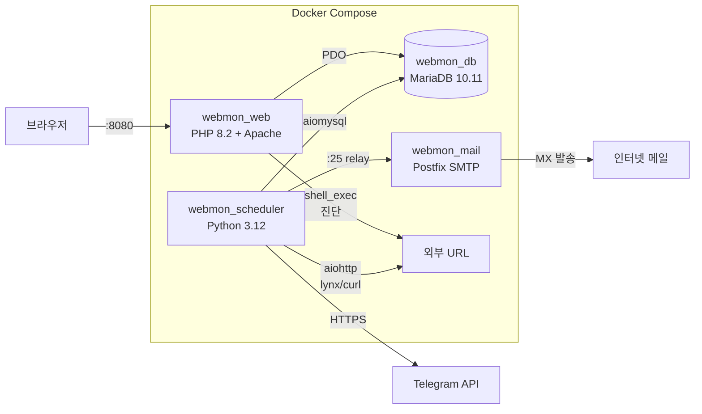
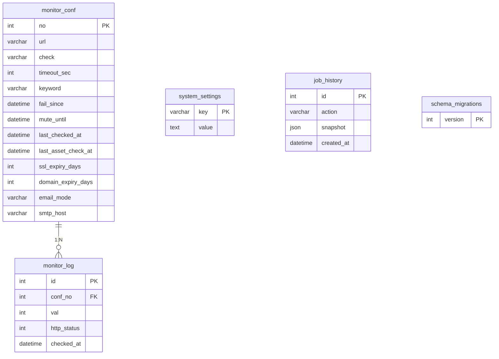
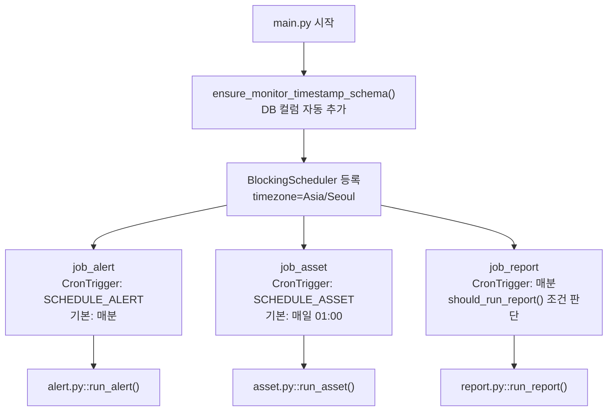
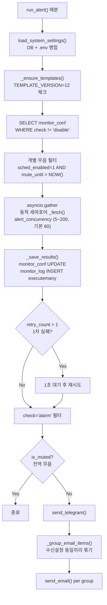
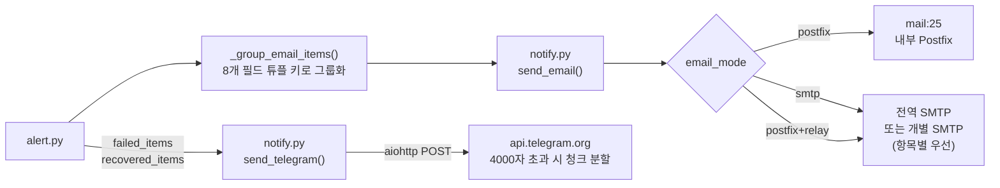
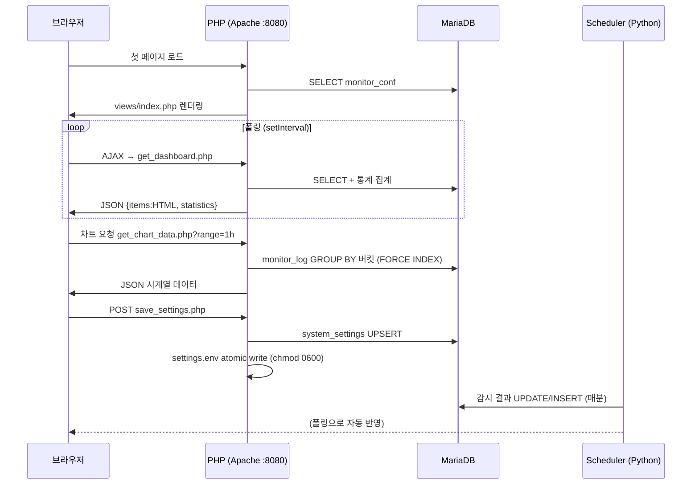

# WebMon 백엔드 동작 구조 분석

## 1. 전체 시스템 아키텍처



**컨테이너 역할:**

| 컨테이너 | 기반 이미지 | 역할 |
|----------|------------|------|
| `webmon_web` | PHP 8.2-apache | 웹 UI, CRUD API, 즉시진단, CSV |
| `webmon_scheduler` | Python 3.12-slim | 주기 감시, SSL/도메인 만료, 알림 |
| `webmon_db` | mariadb:10.11 | 전체 데이터 저장 |
| `webmon_mail` | boky/postfix | 내부 SMTP 릴레이 |
| `webmon_dbpassreset` | PHP 8.2-apache | maintenance 전용 DB PW 리셋 |

**공유 볼륨:**
- `webmon_runtime` → `/var/lib/webmon/settings.env` (민감 자격증명 공유)
- `scheduler_logs` → `/app/logs/alert_engine.log` (RotatingFileHandler)

---

## 2. DB 스키마

**5개 테이블:**



**`monitor_conf` 주요 컬럼:**
- `fail_since` — 장애 시작 시각 (회복 시 NULL)
- `mute_until` — 개별 항목 임시 무음 기한
- `sched_enabled` — 개별 무음 스케줄링 사용 여부
- `last_asset_check_at` — SSL/WHOIS 마지막 조회 시각
- 개별 SMTP: `smtp_host/port/user/pass/secure` per item
- 수신자: `expiry_receiver_email`, `expiry_cc_email` (v2 마이그레이션)

---

## 3. Python 스케줄러 흐름



**Python 의존성:** `APScheduler 3.10.4` / `aiomysql 0.2.0` / `aiohttp 3.9.5`

---

## 4. 웹 감시 프로세스 흐름 (매분)



**단일 URL 체크 `_fetch()`:**

| 엔진 | 명령 | 특이사항 |
|------|------|---------|
| `lynx` | `timeout {N} lynx -source -mime_header -force_secure ...` | 리다이렉트 5홉 직접 추적, gzip 직접 decompress |
| `curl` | `timeout {N} curl -k -s -L --compressed -w "\n__WEBMON_HTTP__%{http_code}"` | 마커로 상태코드 추출 |

**타임아웃 계층:**
- `timeout_sec` (기본 2초) → OS `timeout` 명령
- `timeout_sec + 2` → `asyncio.wait_for` (hang 대비)
- `os.killpg(proc.pid)` SIGKILL → 그룹 킬 (좀비 방지)
- `pids_limit: 4096` 컨테이너 설정으로 PID 상한

**실패 원인 분류:** `timeout` / `connect` / `keyword` / `error`

---

## 5. 알림 발송 흐름



**발송자 우선순위:** `sender_email(항목)` → `global_sender_email` → `smtp_user(이메일형식)` → `webmon@localhost`

**이메일 그룹핑 키:** `(email_mode, sender, receiver, smtp_host, port, user, pass, secure)` 8개 튜플  
→ 같은 수신자에게 여러 항목을 한 통으로 묶어 발송

**알림 템플릿 (`alert_format.py`):**
- Mustache 유사 문법: `{#section}...{/section}`, `{var}`
- `plain` (텔레그램/텍스트) + `html` (이메일 테이블 형식) 2종
- 복구 시: `fail_since` ~ 복구시각 → `format_duration()` 경과시간 계산

---

## 6. PHP API 엔드포인트

**메인 컨트롤러 [`website_status.php`](file:///home/webmon/webmon/website_status.php)**

| method | action | 역할 |
|--------|--------|------|
| GET | `diagnose&no={id}` | 즉시진단 JSON (PHP에서 shell_exec) |
| GET | `delete&no={id}` | 단일 삭제 (스냅샷 → job_history) |
| GET | `rollback_job&job_id={id}` | 스냅샷 복원 롤백 |
| POST | `add / edit` | 항목 추가/수정 |
| POST | `bulk_delete / bulk_status / bulk_update` | 일괄 처리 |
| POST | `csv_import` | CSV 가져오기 |

**AJAX 전용 API:**

| 파일 | 역할 |
|------|------|
| [`get_dashboard.php`](file:///home/webmon/webmon/get_dashboard.php) | JSON `{items: HTML, statistics: {...}}` |
| [`get_chart_data.php`](file:///home/webmon/webmon/get_chart_data.php) | 버킷 집계 JSON (1h/1d/7d/30d, FORCE INDEX) |
| [`get_logs.php`](file:///home/webmon/webmon/get_logs.php) | 커서 페이징 HTML (무한 스크롤) |
| [`get_history.php`](file:///home/webmon/webmon/get_history.php) | 작업이력 HTML (before/after diff UI) |
| [`save_settings.php`](file:///home/webmon/webmon/save_settings.php) | DB UPSERT + `.env` atomic write |
| [`save_item_schedule.php`](file:///home/webmon/webmon/save_item_schedule.php) | 개별 무음 스케줄 UPDATE |
| [`test_notification.php`](file:///home/webmon/webmon/test_notification.php) | 알림 테스트 발송 (JSON 응답) |
| [`csv_export.php`](file:///home/webmon/webmon/csv_export.php) | BOM UTF-8 CSV 다운로드 (14컬럼) |

---

## 7. 프론트엔드 ↔ PHP ↔ DB 데이터 흐름



---

## 8. 설정값 저장/로드 경로 (2-layer) & 지속성

| 설정 종류 | 저장 위치 | 이유 |
|----------|----------|------|
| TG_TOKEN, TG_CHAT_ID, SMTP 자격증명 | `/var/lib/webmon/settings.env` | DB 유출 방지 (0600 권한) |
| 나머지 운영 설정 | `system_settings` 테이블 | 동적 변경 용이 |

**로드 우선순위:** `.env` 파일 값 > DB 값 (양쪽 공통 적용)

**atomic write 흐름:**
```
임시파일 생성 → chmod 0600 → rename() (atomic)
```

**설정 변경 이력 및 롤백:**
- 전역 설정 저장 시 변경 전/후 스냅샷을 `job_history` (`action_type = 'settings_update'`)에 기록
- 설정 실수 시 이전 스냅샷 상태로 즉시 원복(Rollback) 지원

**컨테이너 라이프사이클 (Graceful Stop):**
- systemd 서비스(`webmon.service`)의 종료 명령을 `ExecStop=docker-compose stop`으로 구성하여 컨테이너와 볼륨 파괴 방지

---

## 9. 주요 비즈니스 로직 특이사항

### 동적 동시성 튜닝 (Dynamic Concurrency Tuning)
- `alert_concurrency` 파라미터 (5~200, 기본값 60)를 DB `system_settings`에서 매분 동적으로 읽어 세마포어 적용
- 감시 사이트 증가나 서버 부하 변동 시, 컨테이너 재시작 없이 웹 환경설정에서 실시간 동시성 조절 가능

### 로그 시스템 이원화 (DB vs 파일 로깅)
- **DB 시계열 로그 (`monitor_log`)**: 웹 대시보드 렌더링, 1h~30d 버킷 차트, 실시간 로그 뷰어용. `retention_days`(기본 30일) 경과 시 자동 정리.
- **엔진 텍스트 로그 (`/app/logs/alert_engine.log`)**: 서버 엔지니어 터미널 디버깅용. `RotatingFileHandler` 기반으로 `log_rotate_mb`(기본 50MB) 도달 시 최대 4개 백업 파일로 자동 로테이트하여 디스크 풀 방지.

### 복구 감지
```python
# val==1 (정상) AND prev_value==0 (이전 실패) AND fail_since IS NOT NULL
→ 복구 메시지 발송 + fail_since = NULL 초기화
```

### WHOIS/SSL 최적화 (`asset.py`)
- 조회 조건: 만료 3일 이내 **OR** 마지막 조회 7일+ 경과
- `domain_cache` dict로 같은 도메인 중복 방지
- 조회 간 1.5초 rate-limit 대기
- 한국 2단계 TLD: `{sub}.{sld}.kr` → `{sld}.kr` (KR_TLDS 집합)

### 로그 쿼리 최적화 ([`LogModel.php`](file:///home/webmon/webmon/classes/LogModel.php))
- 100만 행+ 대용량 대응
- 전체 조회: `FORCE INDEX (PRIMARY)` 역순 스캔
- 필터 조회: conf ID 목록 먼저 → `IN (ids)` 필터 (46초 → 0.02초)
- 커서 기반 무한 스크롤 (`before_log_id`)

### 롤백 메커니즘 (`job_history`)
- 작업 전 `snapshot` JSON을 `job_history`에 저장
- 롤백 시: `update`→원복 UPDATE / `delete`→re-INSERT / `csv_import`→DELETE
- 롤백 후 `AUTO_INCREMENT` 카운터 명시 갱신

### 초성 검색 ([`Utils.php`](file:///home/webmon/webmon/classes/Utils.php))
- `ㄱ`→`[가-깋]`, `ㄴ`→`[나-닣]` 등 MariaDB REGEXP 변환
- 초성 + 일반문자 혼합 검색 가능

### 리포트 엔진 (`report.py`)
- 매분 `should_run_report()`: 현재 `HH:MM` == `report_time` AND 현재 요일 in `report_weekdays`
- `report_within_days`일 이내 만료 항목만 HTML 이메일
- 수신자 미지정 시 → 각 항목 `email_mode`에 따라 개별 발송

### 알림 템플릿 자동 업그레이드
- `TEMPLATE_VERSION = "12"` 상수
- 버전 불일치 → DB 모든 템플릿 기본값으로 재설정 (UPSERT)
